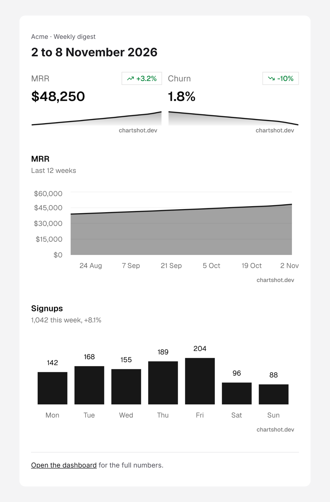
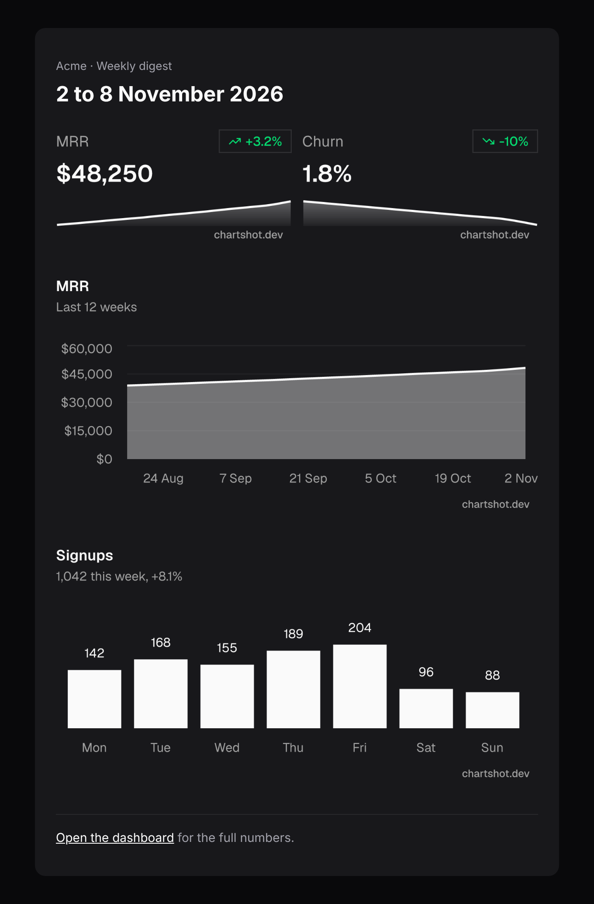

# Weekly digest with charts

A [React Email](https://react.email) template for a weekly metrics email: two KPI tiles, an MRR trend and signups by day. The charts are PNG images drawn by [Chartshot](https://chartshot.dev), which email clients show like any other image.

| Light | Dark |
| --- | --- |
|  |  |

## Run it

Needs Node 22 or later.

```bash
npm install
npm run dev
```

Open http://localhost:3000 to preview. The sample data is in `sample` in `emails/weekly-digest.tsx`.

## How the charts work

Each chart is a JSON spec turned into an image URL. `emails/chart.tsx` picks the URL:

- **No account:** a keyless URL. It works straight away, carries a small Chartshot badge, and is limited to 60 charts a minute per IP address. Each email has four charts, so use it to try the template, not for bulk sends.
- **With a key:** copy `.env.example` to `.env` and set `CHARTSHOT_SECRET_KEY` and `CHARTSHOT_PUBLIC_ID`. The SDK's `ChartImage` then signs each URL, with no badge. Signed URLs need Chartshot Pro and up; with a Free or wrong key, each chart shows an error image that says why.

The URL holds the data and doesn't expire, so the email keeps showing the numbers it was sent with.

## Send it

With [Resend](https://resend.com), set `RESEND_API_KEY` and `TO` in `.env`, then:

```bash
npm run send
```

For any other provider, `render` from `react-email` gives you the HTML.

## Make it yours

- Pass your own numbers as props.
- Set `mode="dark"` for dark charts and colours. Charts are images with their own background, so they don't follow the reader's dark mode.
- Change `theme` in `emails/weekly-digest.tsx` to another built-in theme, or one saved in your Chartshot account.

The [Chartshot docs](https://chartshot.dev/docs/react-email) cover every chart type and option.

## License

MIT
